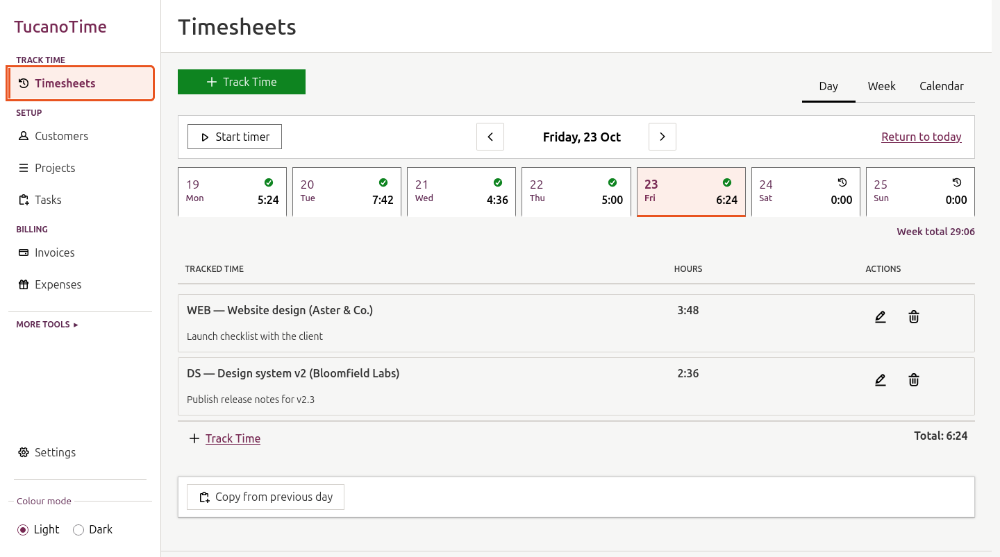

# tucanotime.com

The marketing website for [Tucano Time](https://github.com/TucanoTechnology/TucanoTime) — a free,
self-hosted timesheet and invoicing app for freelancers and small teams.

The site is deliberately boring technology: hand-written HTML, CSS and a small vanilla-JS file.
No build step, no framework, no external fonts, no analytics, no cookies, no third-party requests.
It can be served by GitHub Pages or from a hardened container you own.



## Layout

```
site/                       the entire deployable website
  index.html                homepage
  privacy.html              what the site does and does not collect
  404.html                  branded not-found page
  css/site.css              all styles (design tokens at the top)
  js/site.js                mobile nav, screenshot tabs, copy buttons
  assets/img/               real product screenshots + social card
  assets/brand/             toucan, favicons and Tucano Technology marks
  CNAME                     tucanotime.com, for GitHub Pages
  robots.txt, sitemap.xml, site.webmanifest
Caddyfile                   production headers, clean URLs, 404 handling, health probe
Dockerfile                  Caddy static image
docker-compose.yml          hardened container, loopback-bound by default
docker-compose.tls.yml      optional automatic HTTPS overlay
brand/                      original Tucano Technology source assets (not published)
tools/og-card.html          source for the 1200x630 social card
.github/workflows/          Pages deployment + multi-arch container build
```

## Preview locally

Any static file server works:

```sh
python3 -m http.server -d site 8080
```

Then open <http://localhost:8080/>. There is nothing to install or compile.

Run the repository checks before opening a pull request:

```sh
python3 tools/check-site.py        # links, assets, ids, CSP-safe markup
docker build -t tucanotime-website .  # Caddyfile + image
```

## Hosting

### Option A — GitHub Pages (zero ops)

This is the simplest launch: free, global CDN, managed TLS, and it is already wired up in
[`.github/workflows/pages.yml`](.github/workflows/pages.yml).

1. Push the repository to GitHub (this one is `TucanoTechnology/TucanoTime-Website`).
2. **Settings → Pages → Build and deployment → Source: GitHub Actions.**
3. Run the *Deploy website to GitHub Pages* workflow, or push to `main`.
4. Set the custom domain to `tucanotime.com` and enable **Enforce HTTPS**.
5. At your DNS provider, point the apex at GitHub Pages and `www` at the Pages hostname:

| Type | Name | Value |
| --- | --- | --- |
| A | `@` | `185.199.108.153` |
| A | `@` | `185.199.109.153` |
| A | `@` | `185.199.110.153` |
| A | `@` | `185.199.111.153` |
| CNAME | `www` | `tucanotechnology.github.io` |

Propagation is usually minutes, up to a few hours. GitHub issues the certificate once DNS resolves.
`site/CNAME` keeps the domain recorded in the repository.

The trade-off: GitHub is still a third party serving the marketing page (never the product data).
If that sits badly with the project's message, use option B.

### Option B — self-hosted container

The image is a static Caddy server, built for `linux/amd64` and `linux/arm64`. It runs read-only,
drops every Linux capability, and binds only loopback by default so an existing reverse proxy can
front it.

```sh
docker compose up -d --build
# http://127.0.0.1:8088/
```

Set `SITE_PORT` to move the loopback port. To serve TLS directly with automatic certificates:

```sh
SITE_ADDRESS=tucanotime.com docker compose -f docker-compose.yml -f docker-compose.tls.yml up -d
```

Point the domain's A/AAAA records at the host and allow inbound 80/443. Caddy obtains and renews
the certificate; `caddy-data` keeps it across restarts. Do not run the TLS overlay behind another
proxy that already terminates TLS — use the default compose file there instead.

Published images (built from `main` and `v*` tags):

```
ghcr.io/tucanotechnology/tucanotime-website:latest
ghcr.io/tucanotechnology/tucanotime-website:<version>
ghcr.io/tucanotechnology/tucanotime-website:sha-<short>
```

If you choose the container, disable the Pages workflow (or leave Pages unconfigured) and point DNS
at your server instead of GitHub.

## Changing content

- **Copy and structure:** `site/index.html`. Keep claims factual and check them against the
  [Tucano Time docs](https://github.com/TucanoTechnology/TucanoTime/tree/main/docs).
- **Colour, type, spacing:** design tokens at the top of `site/css/site.css` (`--paper`, `--ink`,
  `--orange`, `--accent-text`, `--wrap`, fonts).
- **Behaviour:** `site/js/site.js` — mobile navigation, screenshot tabs, clipboard buttons. No
  dependencies.
- **Screenshots:** `site/assets/img/shot-*.png` are captures of a real Tucano Time instance seeded
  with fictional demo data. Regenerate them at 1440×940 for desktop and at a narrow mobile width for the hero (the checked-in capture is 500×758);
  never use a real customer's data.
- **Social card:** open `tools/og-card.html` and screenshot the 1200×630 viewport to
  `site/assets/img/og.png`.

### House rules

- No analytics, trackers, cookies, external fonts or CDN scripts. The page must work offline.
- No invented features or pricing. Tucano Time is free software; there is no hosted edition.
- Keep the accessibility bar: keyboard-operable tabs and navigation, visible focus, labelled
  controls, adequate contrast, and motion disabled under `prefers-reduced-motion`.
- If you add an external resource, update the CSP in `Caddyfile` **and** justify why it cannot be
  self-hosted. The default answer is no.

## Contributing

The product lives at [TucanoTechnology/TucanoTime](https://github.com/TucanoTechnology/TucanoTime).
Bug reports, good first issues, documentation fixes and testing on your own hardware are all
welcome there. This repository is just the shop window; the same contribution rules apply.

## Licence

The website source is licensed under [AGPL-3.0-or-later](LICENSE), matching Tucano Time. The Tucano
Technology and Tucano Time names and logos are trademarks of Tucano Technology; the brand assets in
`site/assets/brand/` are provided for this project's official site and should not be used to imply
endorsement elsewhere.
